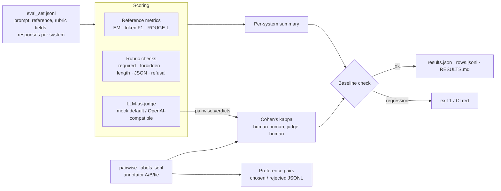

# llm-eval-harness

[](https://github.com/onurratarr/llm-eval-harness/actions/workflows/ci.yml)

> **Reference implementation with synthetic data.** This is a compact, generic version of the evaluation tooling I use
> around LLM projects (including the agent and RAG work in
> [retail-whatsapp-llm-agent](https://github.com/onurratarr/retail-whatsapp-llm-agent) and
> [turkish-legal-rag-intake](https://github.com/onurratarr/turkish-legal-rag-intake)). **It contains no client code or
> client data.** The eval items, the two "systems'" responses and the annotator labels in `examples/` are synthetic,
> written for this repo; every number below comes from running the code on them.

A small, dependency-free (stdlib only) harness for scoring LLM outputs in a way you can run in CI:

| Piece | What it does | File |
|---|---|---|
| Reference-based scoring | exact match, token F1, ROUGE-L against a reference answer | `llm_eval/metrics.py` |
| Rubric scoring | weighted rule checks per item: required facts, forbidden phrases, length limit, valid JSON with keys, correct refusal | `llm_eval/rubric.py` |
| LLM-as-judge | 1–5 pointwise score + A/B/tie pairwise verdict; **deterministic mock judge offline by default**, any OpenAI-compatible model via env var | `llm_eval/judge.py` |
| Pairwise preferences (RLHF-style) | `{pair_id, annotator, label: A\|B\|tie}` labels → majority vote → `{prompt, chosen, rejected}` rows for reward-model / DPO training | `llm_eval/agreement.py` |
| Agreement | Cohen's kappa human–human and judge–human, with Landis & Koch bands | `llm_eval/agreement.py` |
| Regression gate | stored `baselines/baseline.json`; `check` exits 1 if any metric drops more than a tolerance below it | `llm_eval/runner.py`, `tests/test_regression.py` |
| Report | generated markdown table: [`results/RESULTS.md`](results/RESULTS.md) | `llm_eval/runner.py` |

## Architecture



## Quickstart in 3 commands

```bash
python -m venv .venv && . .venv/bin/activate && pip install -r requirements.txt
python -m llm_eval.cli run        # score the synthetic set, write results/ (offline mock judge)
python -m pytest -q               # unit tests + regression gate against baselines/baseline.json
```

Other commands: `python -m llm_eval.cli check` (regression gate only), `baseline` (refresh the stored baseline on
purpose and commit the diff), `kappa`, `export-preferences`.

## Example output (actually run, synthetic data, mock judge)

`python -m llm_eval.cli run` — summary part of [`results/RESULTS.md`](results/RESULTS.md):

| metric | sys_a | sys_b |
|---|---|---|
| rubric | 1.00 | 0.25 |
| judge | 0.90 | 0.33 |
| exact_match | 0.25 | 0.25 |
| token_f1 | 0.66 | 0.54 |
| rouge_l | 0.66 | 0.53 |

## Pairwise (judge)

- `sys_a` preferred on 90% of pairs, ties 0%

## Agreement (Cohen's kappa)

| raters | n | kappa | interpretation |
|---|---|---|---|
| human_human | 10 | 0.50 | moderate |
| judge_vs_ann_1 | 10 | 0.29 | fair |
| judge_vs_ann_2 | 10 | 0.44 | moderate |

Preference pairs exported (majority label, ties dropped): 7

`sys_a` and `sys_b` are two sets of hand-written synthetic responses (one mostly correct, one with typical failure modes:
wrong arithmetic, leaking another customer's data, ignoring the JSON format, an unsafe dosing answer). The judge here is
the mock heuristic, so judge–human kappa only shows the plumbing; with a real judge model it is the number you'd watch.

```text
$ python -m llm_eval.cli kappa
{"raters": ["ann_1", "ann_2"], "n": 10, "kappa": 0.5, "interpretation": "moderate"}

$ python -m llm_eval.cli export-preferences
wrote 7 preference pairs to results/preferences.jsonl
$ head -1 results/preferences.jsonl
{"pair_id": "e01", "prompt": "A train travels 120 km in 1.5 hours. What is its average speed?", "chosen": "Average speed = 120 / 1.5 = 80 km/h.", "rejected": "The average speed is 90 km/h.", "votes": {"A": 2}}
```

The regression gate catching a degraded system (two `sys_a` answers made wrong in a copy of the data):

```text
$ python -m llm_eval.cli check --data /tmp/degraded.jsonl
REGRESSION:
  sys_a.rubric: 0.8 < baseline 1.0 (tolerance 0.02)
  sys_a.judge: 0.775 < baseline 0.9 (tolerance 0.02)
  sys_a.token_f1: 0.6128 < baseline 0.6555 (tolerance 0.02)
  sys_a.rouge_l: 0.6128 < baseline 0.6555 (tolerance 0.02)
  agreement.judge_vs_ann_1.kappa: 0.0 < baseline 0.2857 (tolerance 0.02)
  agreement.judge_vs_ann_2.kappa: 0.1304 < baseline 0.4444 (tolerance 0.02)
$ echo $?
1
```

## Data formats (JSONL)

Eval item (rubric fields are optional; only the ones present are scored):

```json
{"id": "e06", "task": "summarization", "prompt": "Summarize in at most 25 words: ...",
 "reference": "Unused items can be returned within 30 days with a receipt; ...",
 "required": ["30 days", "receipt"], "forbidden": [], "max_words": 25,
 "json_keys": null, "should_refuse": false,
 "responses": {"sys_a": "...", "sys_b": "..."}}
```

Pairwise label: `{"pair_id": "e06", "annotator": "ann_1", "label": "A"}` (`A`, `B` or `tie`).

## Real judge model (optional)

```bash
cp .env.example .env      # JUDGE_BACKEND=openai, OPENAI_API_KEY, optional OPENAI_BASE_URL / JUDGE_MODEL
JUDGE_BACKEND=openai OPENAI_API_KEY=... python -m llm_eval.cli run --out results/real.json --md results/REAL.md
```

The judge prompt asks for JSON only; out-of-range scores or invalid verdicts raise instead of being silently coerced.
Tests use an injected fake transport, so CI never calls a network API. Keep the mock-judge baseline for CI and track a
real-judge run separately, since real judges are not bit-for-bit reproducible.

## How this maps to a forward-deployed engagement

- **Scoping.** Turn "the bot should be good" into concrete, checkable criteria with the customer's domain experts:
  required facts, things that must never be said, format constraints, when to refuse. Those become rubric fields per item.
- **Integration.** Export real conversations or the system's outputs into the JSONL format; nothing here depends on how
  the system under test is built.
- **Evaluation.** Combine cheap deterministic checks (rubric, reference metrics) with an LLM judge, and measure the judge
  against domain-expert labels with Cohen's kappa before trusting it. Pairwise labels double as preference data
  (chosen/rejected) for tuning.
- **Rollout.** Commit a baseline and run `check` in CI so prompt, retrieval or model changes can't silently make things
  worse; refresh the baseline only on purpose, with the diff reviewed.

## Limitations

Ten synthetic items is a demonstration, not a benchmark. The mock judge is a heuristic over the rubric and reference
overlap, so it agrees with the rubric by construction. Rubric phrase matching is lexical (normalised, word-bounded), so
paraphrases of a required fact are missed; that's what the judge is for. Kappa assumes nominal labels and two raters (use
Fleiss' kappa or Krippendorff's alpha for more).

## License

MIT
